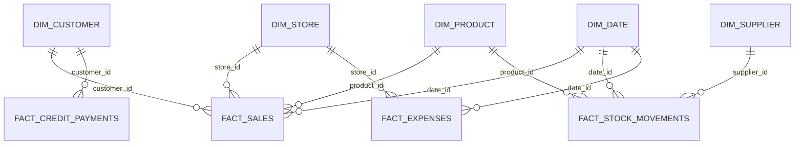

# 01 · Project Documentation — AkatePilot

### A spreadsheet-based sales, inventory management and business intelligence system for a small retail bar in Nigeria.

**AkatePilot = Akate (the bar) + Pilot (an autopilot for stock, sales and business operations).**

The project is designed around the actual operating needs of Akate Bar, a family-run business. It transforms simple daily notebook entries into structured business records, automated calculations, inventory monitoring, customer and supplier records, financial reports and management dashboards.

The central idea is simple: **record transactions once, organise the data automatically and make better business decisions from it.**

---

## 1. Project Identity

| Attribute | Description |
|---|---|
| Project name | AkatePilot |
| Project type | Sales, inventory and business intelligence system |
| Business case | Akate Bar |
| Industry | Retail / Hospitality |
| Location | Nigeria |
| Primary platform | Microsoft Excel |
| Automation | Spreadsheet formulas and built-in functions |
| Data currency | Nigerian Naira (₦) |
| Initial product catalogue | 44 products |
| Intended users | Business owner and authorised operators |
| Portfolio owner | Samson Odion Osarumwense |

## 2. Business Context

AkatePilot was designed from the operational brief of Akate Bar rather than from a generic retail inventory template.

The business has specific operating conditions that influence how its records, inventory and financial calculations must work.

### Business operating profile

| Business attribute | Operating condition |
|---|---|
| Opening time | Approximately 8–10 AM |
| Closing time | Approximately 9–11 PM |
| Operating days | Monday to Sunday |
| Sunday operations | Afternoon start |
| Power supply | Solar-powered |
| Rent | No rent currently paid |
| Employees | No permanently paid staff |
| Product catalogue | 44 products |
| Product types | Alcoholic and non-alcoholic drinks, water and packaging |
| Payment methods | Cash, bank transfer, card and credit |
| Suppliers | Multiple suppliers |
| Purchasing units | Bags, cartons, packs, crates and individual pieces |
| Sales units | Full pack, half pack and individual pieces |
| Pricing | Fixed and variable selling prices |
| Stock losses | Breakage, leakage, expiry and personal consumption |

### Special operating consideration: Sachet water

Sachet water is purchased and managed in bags. Three bags are loaded into the cooler at a time, and sales are managed around the bags rather than recording every individual sachet.

For this reason, AkatePilot records sachet water in **bags, not individual sachets**.

This avoids unnecessary data entry and reflects how the business actually handles the product.

## 3. Problem Statement and Solution

### The problem

Before the proposed system, business transactions were not consistently recorded in a structured format.

This made it difficult to determine:

- How much the business generated in sales.
- How much profit was made.
- How much stock remained.
- Which products sold fastest.
- Which products needed replenishment.
- How much customers owed.
- How much money was collected.
- How much was spent on business operations.
- Whether stock losses were affecting profitability.

Without reliable records, business performance depends heavily on memory and manual calculations.

### The solution

AkatePilot introduces a **notebook-to-workbook pipeline**.

The user records one line per sale or stock transaction. At the end of the day, the recorded information feeds the workbook's calculations, reporting tables and dashboard.

The intended workflow is:

1. Record transactions in the notebook during business operations.
2. Enter each transaction into the appropriate worksheet.
3. Allow formulas and lookup structures to process the entries.
4. Update stock, customer, supplier and credit records.
5. Generate daily summaries and performance reports.
6. Use the dashboard to monitor business performance.

The objective is to minimise duplicate data entry while improving the reliability and visibility of business information.

## 4. System Architecture

The workbook uses a spreadsheet-based architecture in which transaction sheets feed centralised stock calculations and reporting modules.

### Data flow

```text
 NOTEBOOK ──► SALES ─────────┐
              STOCK IN-OUT ──┼──► STOCK (LIVE) ──► DAILY STOCK
              CREDIT ────────┤         │
              EXPENSES ──────┘         ▼
                                      SALES / PRODUCT /
 PRODUCTS ◄──── AUTO-ADD ──┐           CUSTOMER / STOCK
 CUSTOMERS ◄── AUTO-BUILD ┤           REPORTS
 SUPPLIERS ◄── AUTO-BUILD ┘                │
                                          ▼
                                      DASHBOARD

                 DATES · STORE · SETTINGS · LISTS
```

### Workbook colour conventions

| Colour | Meaning |
|---|---|
| Yellow | User input: cells where information is typed |
| Grey | Automatic: formula-generated information |
| Small grey text | Helper columns and supporting calculations |

The colour system helps users distinguish between information they should enter and information the workbook calculates automatically.

### Relational data model

The following entity relationship diagram describes the intended analytical data model.



This structure separates descriptive information from transactional records, supporting consistent reporting and future integration with SQL databases and business intelligence tools.

## 5. Workbook Structure: Sheet-by-Sheet Documentation

The workbook contains four primary transaction-entry sheets and supporting master, calculation and reporting sheets.

| Sheet | Purpose | Primary key / foreign keys |
|---|---|---|
| `SALES` | One row per product line sold | `Sale ID`; FK: `Product ID`, `Customer ID`, `Store ID`, `Date ID` |
| `STOCK IN-OUT` | Opening stock, purchases, breakage, leakage, expiry, personal use, returns and stock corrections | `Movement ID`; FK: `Product ID`, `Supplier ID`, `Store ID`, `Date ID` |
| `PRODUCTS` | Product master with 150 manual slots and 50 auto-added slots | `Product ID` |
| `STOCK` | One live row per product, showing stock, status, cost, margin, days left, suggested purchase and count check | `Product ID` |
| `DAILY STOCK` | Opening-to-closing stock reconciliation for any date | `Product ID` |
| `CUSTOMERS` | Automatically built customer records, spend, visits, credit, status and ranking | `Customer ID` |
| `SUPPLIERS` | Automatically built supplier records from purchases | `Supplier ID` |
| `CREDIT` | Customer credit repayments | `Payment ID`; FK: `Customer ID` |
| `EXPENSES` | Business expenses and owner drawings | `Expense ID` |
| `DATES` | Three-year calendar and daily performance scoreboard | `Date ID` (`yyyymmdd`) |
| `STORE` | Shop master, structured for future multi-branch use | `Store ID` |
| `REPORT` sheets × 4 | Live reporting summaries | — |
| `DASHBOARD` | Visual business performance overview | — |
| `SETTINGS` | Configurable business parameters | — |
| `LISTS` | Dropdown values, category rules and validation lists | — |

### Design principle

The four transaction sheets are the primary user-entry points. Supporting worksheets handle product registration, calculations, reporting, configuration and data validation.

This separation makes the workbook easier to operate and maintain.

## 6. Business Logic: How the Numbers Are Calculated

The calculations are based on the actual purchasing, selling and stock-handling practices of Akate Bar.

### 6.1 Inventory unit conversion

The workbook stores inventory in a consistent base unit.

For most products, the base unit is **pieces**. For sachet water, it is **bags**.

The conversion principle is:

`Base Quantity = Entered Quantity × Conversion Factor`

The conversion factor depends on the transaction unit.

| Transaction type | Conversion factor |
|---|---:|
| Retail: individual piece | 1 |
| Wholesale: half pack | Half the configured pack quantity |
| Wholesale: full pack | Full configured pack quantity |

Purchases can also be recorded using the selected unit: piece, half pack or full pack.

This allows purchases and sales to use different packaging units while maintaining consistent inventory calculations.

### 6.2 Selling price selection

The system uses the following price-selection rule:

`Price Used = Override Price, if entered; Otherwise, Standard Price`

The standard price is based on the product's configured retail or wholesale price.

For wholesale transactions:

- Full-pack price uses the full configured pack price.
- Half-pack price uses the corresponding half-pack calculation.

When a user enters a selling price that differs from the standard price, the transaction is flagged as:

`SPECIAL PRICE`

This helps identify unusual pricing and maintain visibility over selling-price variations.

### 6.3 Weighted average cost

Product cost is calculated using the weighted average cost of priced purchases, including opening stock.

`Weighted Average Cost per Piece = Total Cost of Available Priced Stock ÷ Total Available Base Units`

The profit calculation is:

`Profit = Sales − (Pieces Sold × Average Cost per Piece)`

This approach accommodates changes in purchase prices over time.

It also provides a more representative cost basis than relying permanently on a single default product cost.

### 6.4 Purchase price comparison

The system numbers priced purchases sequentially for each product.

It compares:

- Latest purchase cost per pack.
- Previous purchase cost per pack.
- Absolute price change in naira.
- Percentage price change.
- Price movement trend.

The trend is classified as:

| Condition | Trend |
|---|---|
| Latest cost is higher | UP |
| Latest cost is lower | DOWN |
| No change | SAME |

This supports supplier and purchasing decisions by showing how acquisition costs change over time.

### 6.5 Current stock calculation

`Current Stock = Opening Stock + Added Stock − Sold Stock − Removed Stock`

Stock status is classified as:

| Status | Meaning |
|---|---|
| OK | Stock is above the reorder threshold |
| LOW | Stock is at or below the reorder level |
| OUT | No stock remains |
| CHECK-NEGATIVE | Calculated stock is negative |
| NOT STOCKED YET | Product has not received opening or purchased stock |

### 6.6 Days of stock remaining

The system estimates how long current inventory can support demand using sales activity over the last 30 days.

`Days of Stock Left = Current Stock ÷ (Units Sold in Last 30 Days ÷ 30)`

The suggested purchase quantity is based on a configurable replenishment period.

The default `Days of stock to buy` parameter is 14 days.

This supports proactive replenishment rather than waiting until products are completely out of stock.

### 6.7 Shrinkage and owner drawings

The system distinguishes between stock losses and personal consumption.

**Shrinkage** includes:

- Breakage.
- Leakage.
- Expired products.
- Stock-count losses.

These are valued using the applicable weighted average cost.

**Personal consumption** is valued at cost and recorded as owner cash drawings.

Owner drawings are not treated as business operating expenses.

The net profit calculation is:

`Net Profit = Gross Profit − Business Expenses`

This distinction prevents owner withdrawals from being incorrectly classified as operating costs.

### 6.8 Credit management

The credit module records customer repayments and calculates outstanding balances.

`Outstanding Credit = Credit Sales − Repayments`

An over-limit warning is generated when a customer's outstanding credit exceeds the configured limit.

### 6.9 Customer classification

Customer activity is classified using the number of days since the customer's last recorded activity.

| Status | Activity rule |
|---|---|
| ACTIVE | Last activity within 14 days |
| SLIPPING | Last activity within 30 days |
| LOST | Last activity more than 30 days ago |

These thresholds are editable.

Customer segments include:

| Segment | Classification |
|---|---|
| VIP | Top 20% |
| REGULAR | At least 4 visit-days |
| OCCASIONAL | Occasional purchasing activity |
| ONE-TIME | One recorded visit |

This makes it possible to understand customer engagement and identify customers who may need attention.

### 6.10 Automatic product categorisation

Product categories are assigned through an editable keyword-rule table in `LISTS`.

The classification logic uses the **last matching rule**.

The initial 44-product catalogue has been classified using this rule structure.

Two important classification decisions were retained:

1. Amstel Malta bottle is non-alcoholic but remains under the supplied `BEER & STOUT – BOTTLE` heading.
2. Products initially grouped under `OTHERS` are reclassified into more appropriate subcategories to support better analytics.

These decisions preserve the supplied product organisation while improving analytical categorisation.

## 7. Automation Without Macros

A major design decision in AkatePilot is to use standard spreadsheet formulas and built-in functions rather than depending on VBA macros.

This improves compatibility with supported Excel versions and reduces the need for users to enable macros.

| Requirement | Technique |
|---|---|
| Unique IDs | Formula-based IDs, e.g. `"PRD-"&TEXT(ROW()-5,"000")` |
| Uppercase and trimmed text | Cleaned copy using `UPPER(TRIM())` beside the typed cell |
| Automatic product registration | First-occurrence numbering with `COUNTIF`, followed by `INDEX/MATCH` list building |
| Automatic customer registration | First-occurrence numbering and lookup-based list building |
| Automatic supplier registration | First-occurrence numbering and lookup-based list building |
| Pivot-style reports | `SUMIFS` and `COUNTIFS` reporting grids |
| Top and bottom rankings | `SUMPRODUCT` with tie-breakers |
| Period filtering | Two dropdown selectors controlling named ranges |
| Category filtering | Category dropdown controlling `CatCrit` |
| Automatic date carry-forward | Formula-based lookup of the previous date |
| Alerts | Conditional formatting and `Check` columns |
| Search | Yellow search box, row highlighting, filter arrows and type-ahead dropdowns |

### 7.1 Automatic ID generation

Unique identifiers are generated through formulas.

Example:

`"PRD-"&TEXT(ROW()-5,"000")`

The same principle is applied to relevant transaction and reference tables.

### 7.2 Automatic product, customer and supplier lists

The workbook uses first-occurrence numbering with `COUNTIF` and lookup formulas to build lists automatically.

This approach avoids dependence on the newer `UNIQUE()` function and supports older Excel environments.

### 7.3 Reporting and ranking

Reports use:

- `SUMIFS`
- `COUNTIFS`
- `SUMPRODUCT`
- `INDEX`
- `MATCH`

These formulas generate summary grids, rankings and self-sorting Top/Bottom lists.

### 7.4 Interactive filters

The reporting system uses two dropdown selectors:

- Period.
- Product type/category.

These selectors control the named ranges:

- `PeriodFrom`
- `PeriodTo`
- `CatCrit`

This provides a slicer-style filtering experience without requiring PivotTable slicers.

### 7.5 Automatic date carry-forward

The date-entry system is formula-based.

In rows 7 and above of:

- `SALES`
- `STOCK IN-OUT`
- `CREDIT`
- `EXPENSES`

The date formula is:

```excel
=IF(C7="","",IFERROR(LOOKUP(9.99E+307,B$6:B6),""))
```

The formula:

1. Checks whether a transaction input has been entered in column C.
2. Returns blank when there is no entry.
3. Finds the most recent date above the current row.
4. Carries that date into the current transaction row.
5. Allows a new date to be entered to begin a new trading day.

This supports the notebook-to-workbook workflow where a date is entered once per day rather than repeatedly typed for every transaction line.

### 7.6 Alerts and search

Conditional formatting highlights important stock and transaction conditions.

The workbook also includes:

- A yellow search box.
- Row highlighting based on search input.
- Filter arrows.
- Type-ahead dropdowns.

These features help users locate information without navigating through large transaction tables manually.

## 8. Data Dictionary and Export Standards

Each worksheet contains its own header row, defining the fields used by that part of the system.

The export structure is documented in:

`sql/schema.sql`

### Data standards

| Data type | Standard |
|---|---|
| Currency | Nigerian Naira (NGN) |
| Spreadsheet date | `dd-mmm-yyyy` |
| CSV date | ISO `yyyy-mm-dd` |
| Export column names | `snake_case` |
| Product identifiers | Unique product IDs |
| Customer identifiers | Unique customer IDs |
| Supplier identifiers | Unique supplier IDs |
| Store identifiers | Unique store IDs |
| Transaction identifiers | Unique transaction IDs |

The data dictionary and SQL schema provide the foundation for exporting the workbook into a relational database or analytical environment.

## 9. Testing and Validation Performed

Testing is an important part of AkatePilot because the workbook is intended to support actual business operations.

The following validation activities have been performed according to the project test results.

### 9.1 Formula recalculation

- 273,227 formulas recalculated.
- Zero formula errors were reported.
- Testing covered both the demonstration workbook and blank template.

### 9.2 Independent Python validation

An independent Pandas-based check was performed.

The following outputs were reproduced:

- Sales totals.
- Profit.
- Weighted average cost.
- Stock balances.

The comparison covered all 45 product records in the test dataset.

**Maximum difference: 0.**

### 9.3 SQL validation

CSV exports were loaded into SQL.

The following were reproduced:

- Monthly sales.
- Stock reconciliation.

**Reconciliation difference: 0.**

### 9.4 Live-entry testing

The blank template was tested using realistic entry scenarios.

The tests included:

- Lowercase input.
- Extra spaces.
- Automatic text cleaning.
- Automatic product creation.
- Automatic supplier creation.
- Automatic customer creation.
- Wholesale quantity conversion.
- Credit balances.
- Daily stock calculations.

The tested outputs were correct according to the project validation results.

### 9.5 Compatibility testing still outstanding

The workbook has been tested in:

- Google Sheets.
- Microsoft Excel for Android.
- Microsoft Excel for iOS.

These environments may handle some spreadsheet functions and formula behaviour differently.

The workbook uses Excel 2019+ standard functions. `MINIFS` and `MAXIFS` are also supported by Google Sheets.

**Users have tested the workbook on their own devices and reported any compatibility issues before relying on it for live business operations.**

## 10. Known Limitations and Maintenance

AkatePilot has defined capacity limits for each workbook copy.

### Workbook capacity

| Component | Capacity |
|---|---:|
| Sales lines | 8,000 |
| Stock movements | 1,500 |
| Expenses | 700 |
| Credit repayments | 1,000 |
| Products | 150 manual + 50 automatic |
| Customers | 300 |
| Suppliers | 100 |

### Annual workbook maintenance

A fresh yearly copy should be saved when beginning a new business year.

The recommended process is:

1. Save a new copy of the workbook.
2. Clear previous-year yellow input cells.
3. Preserve the master lists and workbook configuration.
4. Carry forward closing stock as the new year's `OPENING STOCK`.
5. Confirm the opening balances before recording new transactions.

### Important operating restrictions

**Do not sort or delete rows on data-entry sheets.**

The workbook uses position-based identifiers in some areas, so sorting or deleting rows may affect the integrity of generated IDs.

Use filter arrows to view records in a different order without rearranging the underlying data.

### Customer-name consistency

Typing different versions of the same customer name can create separate customer records.

For example:

- `MR ADE`
- `ADE`

These may be interpreted as different customers.

Users should select existing customer names from the dropdown wherever possible.

## 11. Language, Currency and Formatting Standards

The workbook uses UK English throughout.

Examples include:

- Colour.
- Programme.
- Licence.
- Organisation.

Formatting standards:

| Element | Format |
|---|---|
| Currency | ₦ |
| Currency code | NGN |
| Spreadsheet dates | `dd-mmm-yyyy` |
| CSV dates | `yyyy-mm-dd` |
| Export column names | `snake_case` |
| Product and customer names | Standardised text |

These standards maintain consistency across the workbook, documentation, exports and reports.

## 12. Integration with Power BI, Tableau, SQL and Python

AkatePilot is designed to function as more than a spreadsheet.

Its structured data can be exported and used for advanced analytics and visualisation.

### 12.1 Power BI and Tableau

The CSV exports can be loaded into Power BI or Tableau.

The analytical model uses relationships based on:

- `Date ID`
- `Product ID`
- `Customer ID`
- `Supplier ID`
- `Store ID`

In Power BI, `dim_date` should be marked as the official date table.

### Suggested Power BI measures

**Total Sales**

```dax
Sales =
SUM(fact_sales[total_sales])
```

**Gross Profit**

```dax
Gross Profit =
SUM(fact_sales[profit])
```

**Profit Margin**

```dax
Margin % =
DIVIDE([Gross Profit], [Sales])
```

**Stock Value**

```dax
Stock Value =
SUM(snapshot_stock[stock_value_at_cost])
```

These measures provide a starting point for the business intelligence dashboard.

### 12.2 SQL

The SQL implementation includes:

```text
sql/
├── schema.sql
└── sample_queries.sql
```

The schema defines the relational database structure, while the sample queries demonstrate how to retrieve and analyse business information.

Potential SQL analysis includes:

- Monthly sales performance.
- Product profitability.
- Customer purchasing behaviour.
- Credit balances.
- Supplier purchasing patterns.
- Stock reconciliation.
- Inventory valuation.

### 12.3 Python

The Python analysis file is:

```text
python/
└── analysis.py
```

It includes analytical workflows for:

- Pareto analysis.
- RFM customer analysis.
- Simple demand forecasting.

Python provides an opportunity to extend the workbook's analytical capabilities beyond spreadsheet formulas.

### 12.4 Data integration workflow

```text
AKATEPILOT WORKBOOK
        │
        ▼
     CSV EXPORTS
        │
        ├────────► SQL DATABASE
        │
        ├────────► PYTHON ANALYSIS
        │
        ├────────► POWER BI
        │
        └────────► TABLEAU
```

This structure allows the same operational records to support multiple analytical environments.

## 13. Dataset Anonymisation

All published demonstration data is synthetic and generated using a seeded generator.

The dataset uses:

| Data field | Published representation |
|---|---|
| Customer names | `CUSTOMER 01` to `CUSTOMER 25` |
| Supplier names | `SUPPLIER A` to `SUPPLIER D` |
| Prices | Illustrative |
| Pack sizes | Illustrative |
| Phone numbers | Not included |
| Addresses | Not included |

The brand names are real product names collected manually for the business product catalogue.

If the workbook is published as a client project under a non-disclosure agreement, real brand names should be removed or masked where required.

No private customer or supplier information should be included in the public GitHub repository.

---

## 14. Project Significance

AkatePilot demonstrates how data analytics can be applied to a real small-business environment where transaction recording, inventory management and financial visibility are often handled manually.

The project combines:

- Spreadsheet engineering.
- Business process analysis.
- Inventory management.
- Financial calculations.
- Formula-based automation.
- Data validation.
- Data modelling.
- SQL integration.
- Python-based analysis.
- Business intelligence and reporting.

More importantly, it demonstrates that effective analytics begins with understanding how a business actually operates.

The system was designed around the specific purchasing units, selling arrangements, stock losses, credit practices and operating conditions of Akate Bar.

The long-term objective is to develop a reusable, affordable and adaptable business management and analytics solution for small businesses in Nigeria.

## 15. Author

**Samson Odion Osarumwense**

Data Analyst | Microsoft Certified Power BI Data Analyst Associate | Business Intelligence and Automation Enthusiast

Core interests:

- Business Intelligence and Data Visualisation.
- Spreadsheet Automation.
- SQL and Python.
- Operational and Commercial Analytics.
- Data Modelling.
- Data-Driven Decision-Making.

**Project:** AkatePilot  
**Business Case:** Akate Bar  
**Country:** Nigeria

---

## 16. Disclaimer

AkatePilot is an independent portfolio project developed around a real small-business use case.

The workbook and its supporting analytical components are intended to demonstrate practical applications of spreadsheet automation, data management and business intelligence.

The published demonstration data is synthetic and should not be interpreted as actual business financial performance.

Features and compatibility should be evaluated against the documented testing results. Mobile and Google Sheets compatibility remain subject to further testing.

**© 2026 Samson Odion Osarumwense.**
