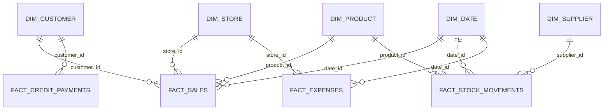

# 01 · Project Documentation — AkatePilot

## 1. Name
**AkatePilot** — *Akate* (the bar) + *Pilot* (an autopilot for stock & sales).

## 2. Business context (from the owner's brief)
Open 8–10am to 9–11pm daily (Sundays: afternoon start) · solar powered, no rent, no paid staff · 44 products (alcoholic & soft drinks in bottles/cans, bottled & sachet water, packaging) · payments: cash, transfer, card, credit · bought as bags/cartons/packs/crates/pieces from several suppliers · sold wholesale (full/half) and retail (piece) · some fixed, some variable prices · breakage, leakage and personal consumption happen · sachet water is loaded 3 bags at a time, so **bags**, not sachets, are recorded.

## 3. Problem → Solution
**Problem:** nothing recorded → unknown profit, loss and stock.
**Solution:** a notebook-to-workbook pipeline. User write a line per sale; one evening entry per line gives automatic profit, stock, customers, credit, reports and a dashboard.

## 4. Architecture
```
 NOTEBOOK ──► SALES ───────┐
              STOCK IN-OUT ─┼─► STOCK (live) ─► DAILY STOCK
              CREDIT ───────┤        │
              EXPENSES ─────┘        ▼
   PRODUCTS ◄─ auto-add ─┐    SALES/PRODUCT/CUSTOMER/STOCK REPORTS ─► DASHBOARD
   CUSTOMERS ◄ auto-build┤        ▲
   SUPPLIERS ◄ auto-build┘   DATES · STORE · SETTINGS · LISTS
```
Colour code: **yellow = type here**, **grey = automatic**, small grey = helper.



## 5. Sheet-by-sheet
| Sheet | Purpose | Primary key / foreign keys |
|---|---|---|
| SALES | One row per product line sold | `Sale ID` · FK `Product ID`, `Customer ID`, `Store ID`, `Date ID` |
| STOCK IN-OUT | Opening stock, purchases, breakage, leakage, expiry, personal use, returns, count corrections | `Movement ID` · FK `Product ID`, `Supplier ID`, `Store ID`, `Date ID` |
| PRODUCTS | Product master (150 manual slots + 50 auto-added) | `Product ID` |
| STOCK | One live row per product: stock, status, cost, margin, days left, suggested buy, count check | `Product ID` |
| DAILY STOCK | Opening → closing stock for any date | `Product ID` |
| CUSTOMERS | Auto-built from sales; spend, visits, credit, status, rank | `Customer ID` |
| SUPPLIERS | Auto-built from purchases | `Supplier ID` |
| CREDIT | Repayments from customers | `Payment ID`, FK `Customer ID` |
| EXPENSES | Business expenses and owner drawings | `Expense ID` |
| DATES | Calendar + daily scoreboard (3 years) | `Date ID` (yyyymmdd) |
| STORE | Shop master (multi-branch ready) | `Store ID` |
| 4 × REPORT, DASHBOARD | Live summaries and visuals | — |
| SETTINGS, LISTS | Parameters, drop-downs, category rules | — |

## 6. Business logic (how the numbers are made)
* **Pieces** — everything is stored in *pieces* (sachet water: *bags*). `Pieces = Quantity × factor`, factor = 1 (retail), ½ pack (wholesale half), full pack (wholesale full). Purchases use the unit chosen (piece / half pack / full pack).
* **Price used** = override if typed, else standard (retail price; wholesale per pack ÷ 1 or 2). Differences are flagged `SPECIAL PRICE`.
* **Cost** = *weighted average cost per piece* of all priced purchases (opening stock included). `Profit = Sales − Pieces × Average cost`.
* **Old vs new price** — each priced purchase is numbered per product; *latest* vs *previous* cost per pack, change ₦/%, trend UP/DOWN/SAME.
* **Current stock** = opening + added − sold − removed. Status: OK / LOW (≤ reorder level) / OUT / CHECK-NEGATIVE / NOT STOCKED YET.
* **Days of stock left** = stock ÷ (sold in last 30 days ÷ 30). **Suggested buy** covers `Days of stock to buy` (default 14).
* **Shrinkage** — breakage, leakage, expiry, count loss valued at average cost; **personal use** valued at cost + owner cash drawings. Net profit = gross profit − business expenses (drawings are *not* an expense).
* **Credit** — CREDIT sales minus repayments = money owed; over-limit warning.
* **Customer status** — ACTIVE ≤14 days, SLIPPING ≤30, LOST >30 (editable). Segments: TOP 20% (VIP), REGULAR (≥4 visit-days), OCCASIONAL, ONE-TIME.
* **Auto categories** — an editable keyword rule table (`LISTS`): the last matching rule wins. Your 44 products are all classified correctly (tested). Note: *Amstel Malta* bottle is non-alcoholic but kept under the "BEER & STOUT – BOTTLE" heading you supplied; the "OTHERS" group is re-classified into proper subcategories for better analytics.

## 7. Automation without macros — how
| Requirement | Technique |
|---|---|
| Unique IDs | `"PRD-"&TEXT(ROW()-5,"000")` etc. |
| UPPERCASE + trimmed | cleaned copy: `UPPER(TRIM())` beside the typed cell |
| Auto-add new product/customer/supplier | "first-occurrence numbering" helper (`COUNTIF` on an expanding range) + `INDEX/MATCH` list builder — works without `UNIQUE()` so it runs in any Excel |
| Pivot-style reports | `SUMIFS/COUNTIFS` grids; ranks via `SUMPRODUCT` with tie-breakers (self-sorting Top/Bottom lists) |
| Slicers | two drop-down selectors (period, product type) drive named ranges `PeriodFrom/PeriodTo/CatCrit` |
| Date typed once per day | in rows 7+ of SALES, STOCK IN-OUT, CREDIT, EXPENSES the Date cell is `=IF(C7="","",IFERROR(LOOKUP(9.99E+307,B$6:B6),""))` — it copies the last date above once a product is typed; type a new date over it to start a new day |
| Alerts | conditional formatting + `Check` columns |
| Search | yellow search box (row highlight) + filter arrows + type-ahead drop-downs |

## 8. Data dictionary (key columns)
See header row of each sheet. Export columns (snake_case) are listed in `sql/schema.sql`. Money = NGN, dates `dd-mmm-yyyy` in the sheets and ISO `yyyy-mm-dd` in CSV.

## 9. Testing performed
* 273,227 formulas recalculated with **0 errors** (demo and blank template).
* Independent pandas check: sales total, profit, weighted cost and stock for all 45 products reproduced exactly (max difference 0).
* SQL load of the CSVs reproduced monthly sales and stock reconciliation (difference 0).
* Live-entry test in the blank template: messy typing (lowercase, extra spaces) cleaned; new product, supplier and customer auto-created; wholesale pieces, credit owed and daily stock all correct.
* **Not Tested:** opening in Google Sheets and Excel mobile — please test on your devices and report any function that does not carry over (all functions used are Excel-2019+ standard; `MINIFS/MAXIFS` are supported by Sheets).

## 10. Known limits & maintenance
Capacity: 8,000 sales lines, 1,500 stock movements, 700 expenses, 1,000 repayments, 150+50 products, 300 customers, 100 suppliers per file — save a fresh yearly copy (clear yellow cells, keep closing stock as new *OPENING STOCK*). Don't sort or delete rows on data sheets (IDs are position-based) — filter instead. Typing a customer name differently (e.g. "MR ADE" vs "ADE") creates two customers; pick from the drop-down.

## 11. UK English & formats
All labels use UK English (*colour, programme, licence, organisation*), `₦` currency, `dd-mmm-yyyy`.

## 12. Power BI / Tableau / SQL / Python
Load the 10 CSVs in `data/` (or the sheets `SALES`, `STOCK IN-OUT`, `PRODUCTS`, `CUSTOMERS`, `SUPPLIERS`, `DATES`, `STORE`, `EXPENSES`, `CREDIT`). Relationships: `Date ID`, `Product ID`, `Customer ID`, `Supplier ID`, `Store ID`. In Power BI mark `dim_date` as the date table. Suggested measures: `Sales = SUM(fact_sales[total_sales])`, `Gross Profit = SUM(fact_sales[profit])`, `Margin % = DIVIDE([Gross Profit],[Sales])`, `Stock Value = SUM(snapshot_stock[stock_value_at_cost])`. `sql/schema.sql` + `sample_queries.sql` and `python/analysis.py` (Pareto, RFM, simple demand forecast) are ready to run.

## 13. Anonymisation of the dataset
All data is synthetic (seeded generator): customers are `CUSTOMER 01…25`, suppliers are `SUPPLIER A–D`, prices/pack sizes are illustrative, no phone numbers or addresses. The brand names are real product names collected manually; remove or mask them if you publish for a client under NDA.
